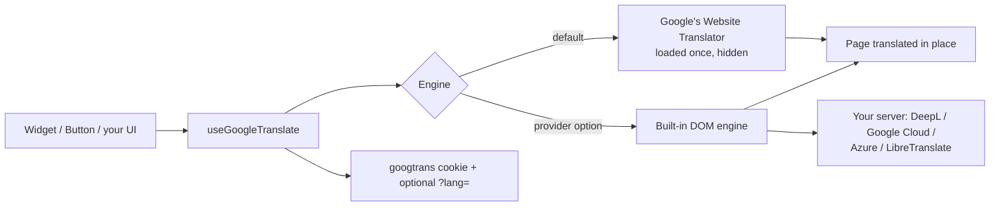

# Vue Google Translate Widget

[](https://www.npmjs.com/package/@ken_de_nigerian/vue-google-translate-widget)
[](https://www.npmjs.com/package/@ken_de_nigerian/vue-google-translate-widget)
[](https://github.com/ken-de-nigerian/vue-google-translate-widget/actions/workflows/tests.yml)
[](https://ken-de-nigerian.github.io/vue-google-translate-widget/)
[](https://www.npmjs.com/package/@ken_de_nigerian/vue-google-translate-widget)
[](LICENSE)

**[Documentation website](https://ken-de-nigerian.github.io/vue-google-translate-widget/)** (try the live demo:
the site translates itself) · [Quick Start](docs/quick-start.md) · [Nuxt](docs/nuxt.md) ·
[API Reference](docs/api-reference.md)

## What is it?

Making a site readable in many languages usually means maintaining translations. For a lot of sites (blogs, docs,
shops, community and government sites) machine translation of the rendered page is good enough, and Google's free
Website Translator does it. Used raw, though, it's a 2009-era widget: an unstyled dropdown, a banner that pushes your
page down, reloads, no Vue state, no keyboard support, and a single point of failure.

This package gives you that translation behind **a polished, accessible Vue component**:

```vue
<script setup>
import { GoogleTranslateWidget } from '@ken_de_nigerian/vue-google-translate-widget'
import '@ken_de_nigerian/vue-google-translate-widget/style.css'
</script>

<template>
  <GoogleTranslateWidget :included-languages="['en', 'fr', 'de', 'yo', 'ig', 'ha']" />
</template>
```

The visitor picks a language and the page is translated **in place**, without reloading. The choice is remembered
across pages. Google's banner is hidden, right-to-left languages get `dir="rtl"`, and your brand names stay as they
are.

And if you'd rather not depend on Google's free widget, swap it for **DeepL, Google Cloud, Azure or
LibreTranslate**, with the API key kept on your server. The components and API stay the same.

## Is this for you?

A good fit if you want:

- a language switcher for a Vue 3 or Nuxt site, translating content you don't want to translate by hand;
- it to be accessible, themeable and work with SSR;
- the option to move off Google's free widget later without changing your UI.

**Not** a fit if you need reviewed, hand-written translations, pluralisation or locale-aware formatting: that's
[vue-i18n](https://vue-i18n.intlify.dev/). Machine-translated pages are also not indexed by search engines in other
languages, so this isn't a multilingual SEO solution. Many sites use both: vue-i18n for the UI chrome, this package
for everything else.

## How it fits together



The full walkthrough, including what it can't do, is in [How It Works](docs/how-it-works.md).

## Quick Start

```bash
npm install @ken_de_nigerian/vue-google-translate-widget
```

**Vue:** drop in a component (above), or set defaults once for the whole app:

```ts
import { createGoogleTranslate } from '@ken_de_nigerian/vue-google-translate-widget'
import '@ken_de_nigerian/vue-google-translate-widget/style.css'

app.use(createGoogleTranslate({ defaultLanguage: 'en', includedLanguages: ['fr', 'de', 'es'] }))
```

**Nuxt:** add the module; components and the composable are auto-imported, and the visitor's language is rendered
on the server:

```ts
// nuxt.config.ts
export default defineNuxtConfig({
  modules: ['@ken_de_nigerian/vue-google-translate-widget/nuxt'],
  googleTranslate: { includedLanguages: ['en', 'fr', 'de'] },
})
```

**Your own UI:** use the composable:

```ts
const { currentLanguage, languages, changeLanguage, initializeTranslate } = useGoogleTranslate()
```

More in the [Quick Start](docs/quick-start.md).

## What you get

| | |
| --- | --- |
| ⚡ **No reloads** | Translates in place; restoring the original is instant; the choice persists |
| ♿ **Accessible** | A real dialog and listbox, full keyboard support, focus management, announcements; axe-checked in CI |
| 🔌 **Not locked to Google** | DeepL, Google Cloud, Azure, LibreTranslate or your own API, keys kept server-side |
| 🟢 **Nuxt module** | Auto-imports, SSR of the saved language, `?lang=` links, no hydration mismatches |
| 🎨 **Yours to style** | Light/dark/auto, 17 CSS custom properties, slots, or fully unstyled |
| ↔️ **RTL** | `dir="rtl"` for Arabic, Hebrew, Persian, Urdu and more |
| 🧠 **Smart extras** | Pinned and recent languages, browser-language prompt or auto-translate, emoji flags, lazy loading, `v-no-translate` |
| 📈 **Analytics hook** | `onTranslate` for GA4, Plausible, PostHog |
| 📦 **Small** | ~11 kB for the Widget, ~6.6 kB headless (brotli); no runtime dependencies |
| 🧪 **Testable** | A fake of Google's widget for your own tests, from `/testing` |
| ✅ **Tested** | 386 tests on Vue 3.3–3.5 with a 92.6% mutation score, real Nuxt 3 and 4 builds, the published tarball checked as ESM, CommonJS and types, WCAG contrast, and a weekly check against Google's live widget |

## Documentation

**Getting started**

1. [Installation](docs/installation.md)
2. [Your First Language Switcher](docs/quick-start.md): a working switcher on a real page, step by step
3. [How Translation Works](docs/how-it-works.md): what happens when a visitor picks a language, and the limits
4. [Nuxt](docs/nuxt.md): the module, server rendering, shareable `?lang=` links

**Using the package**

5. [GoogleTranslateWidget](docs/widget.md): the floating switcher
6. [GoogleTranslateButton](docs/button.md): the navbar dropdown
7. [Building Your Own Switcher](docs/composable.md): `useGoogleTranslate`
8. [Configuration](docs/plugin.md): set options once for the whole app; automatic translation
9. [Keeping Text Untranslated](docs/directive.md): `v-no-translate`

**Customising**

10. [Theming](docs/theming.md): dark mode, CSS custom properties, unstyled
11. [Languages & Flags](docs/languages.md): codes, ordering, flag styles
12. [Right-to-Left Languages](docs/rtl.md)

**Behaviour**

13. [Live and Reload Modes](docs/live-vs-reload.md)
14. [Events & Analytics](docs/events-and-analytics.md)

**Going further**

15. [Translation Providers](docs/providers.md): DeepL, Google Cloud, Azure, LibreTranslate, your own
16. [Server Handlers](docs/server-handlers.md): keep API keys on your server
17. [Testing Your App](docs/testing.md): a fake of Google's widget for your tests

**Shipping it**

18. [Performance](docs/performance.md)
19. [Accessibility](docs/accessibility.md)
20. [Security, CSP & Privacy](docs/csp-and-privacy.md)
21. [Production Checklist](docs/production-checklist.md)

**When things go wrong**

22. [Troubleshooting](docs/troubleshooting.md)
23. [FAQ](docs/faq.md)

**Reference**

24. [API Reference](docs/api-reference.md)
25. [Architecture](docs/architecture.md): how it's built, the decisions behind it, how it's tested
26. [Upgrade Guide](docs/upgrade-guide.md)
27. [Changelog](CHANGELOG.md)
28. [Contributing](CONTRIBUTING.md)

The same chapters, with search and a live demo, are on the
**[documentation website](https://ken-de-nigerian.github.io/vue-google-translate-widget/)**.

## Changelog

[CHANGELOG.md](CHANGELOG.md) has every release; breaking changes and how to handle them are in the
[Upgrade Guide](docs/upgrade-guide.md). What's next is in [ROADMAP.md](ROADMAP.md).

## License

MIT. See [LICENSE](LICENSE).

## Support

If this package is useful to you, starring the repository helps other people find it. Bug reports, docs fixes and
code are welcome: see [Contributing](CONTRIBUTING.md), and please report security issues privately
([SECURITY.md](SECURITY.md)).

---

**Built for the Vue community by [Ken De Nigerian](https://github.com/ken-de-nigerian)**
