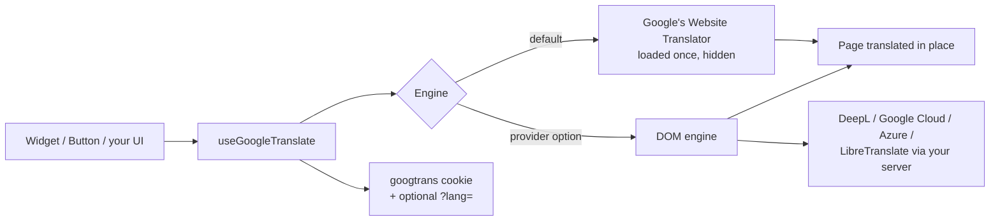

# How It Works

**Who this is for:** anyone deciding whether this package fits, or debugging it. **At the end** you'll know what
happens when a visitor picks a language, and the limits of machine translation in the browser.

## With Google's free widget (the default)

1. On mount, Google's script is loaded **once per page** into a hidden element. Every component and composable on
   the page shares it: Google only renders the first translator on a page, so the package makes sure there is
   exactly one.
2. When a visitor picks a language, the package sets Google's own (hidden) language selector. Google translates the
   page **in place**, typically in about a second (the very first translation of a session can take longer while
   Google warms up).
3. The choice is saved in Google's `googtrans` cookie. Restoring the original language clears it on every domain
   level, including the parent-domain copy Google writes for subdomains.
4. Choosing the original language clicks Google's own "Show original" button, so that's instant too. If that
   button isn't available, the page reloads instead.
5. Google's banner, tooltips and highlight are hidden, and its 40px body offset undone (`hideBranding`).
6. For right-to-left languages, `<html dir="rtl">` is set (Google only adds a class), and restored afterwards.

## With a provider

Pass a `provider` and Google's script is never loaded. Instead, the package's own **DOM engine** walks the page's
text and a few attributes (`placeholder`, `title`, `alt`, `aria-label`), skips anything marked `notranslate`, sends
the distinct strings to your provider in batches, caches the results, and writes them back. It follows content Vue
renders later (route changes, `v-if`), and keeps the originals so restoring is instant. See
[Translation Providers](./providers.md).

## What it is, and isn't

This is **machine translation of the rendered page**. It's a good fit for content sites, docs, shops and
dashboards that want to be readable in many languages without maintaining translations.

It is **not** a replacement for [vue-i18n](https://vue-i18n.intlify.dev/) when you need reviewed, hand-written
translations, pluralisation rules or locale-aware formatting. Many sites use both: vue-i18n for the UI chrome in a
few languages, and this package to make the content readable in dozens more.

::: warning Google's free widget
Google stopped offering the Website Translator to new sites in 2019. It still works (a CI job checks the live
widget every week), but Google gives no guarantee it will keep working. If that risk matters to you, use a
[provider](./providers.md): the same components and API, backed by a service you control.
:::
