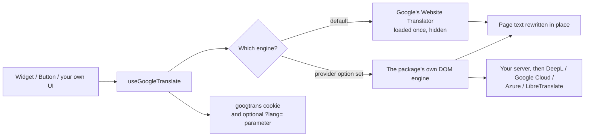

# How Translation Works

You can use this package without reading this chapter. It's here for when you need to decide whether the package
fits, explain it to someone else, or work out why something isn't behaving. It covers what happens between a visitor
clicking a language and the page changing, where the choice is stored, and what machine translation in the browser
can and can't do.

## The two engines

Every component and the `useGoogleTranslate()` composable sit on top of one of two translation engines:

**Google's Website Translator** is the default. It's free, needs no account and no server code, and covers 248
languages. It's what most sites use.

**The DOM engine** takes over when you pass a `provider`. Google's script is never loaded; the package translates the
page itself, through a translation service you choose. You'd use it to avoid depending on Google's free widget, for
DeepL's quality, or to keep page text away from Google entirely. [Translation Providers](providers.md) covers it in
full; the rest of this chapter describes the default engine and points out where the DOM engine differs.

Both engines sit behind the same API. Components, events, the cookie, `?lang=` links and right-to-left handling work
the same way whichever one is active.

## What happens when the page loads

When the first component mounts (or you call `initializeTranslate()`), the package loads Google's script, once per
page, into a hidden element it creates for the purpose. Google only ever renders one translator per page, so every
component and composable on the page shares this one. That's also why they always agree on the current language.

Two things are worth knowing about this step:

- **It can fail, and that's handled.** Ad blockers, privacy extensions, strict Content Security Policies and some
  networks block Google's script. If it hasn't loaded within ten seconds (`timeout`), `status` becomes `'error'`, the
  components show a short message in their popup, and the `error` event fires. Nothing else on your page is affected.
- **If the visitor already chose a language**, the package makes sure it's applied as soon as Google is ready, so a
  returning visitor sees their language without doing anything.

If you'd rather not load anything until the visitor shows interest, the `lazy` prop defers this step until the
switcher is first opened. [Performance](performance.md#lazy-loading) explains the trade-off.

## What happens when a visitor picks a language

1. The package tells Google which language was chosen. It does this by setting Google's own language selector, which
   lives in the hidden element. This is what makes translation happen in place, with no page reload.
2. Google sends the page's text to its translation service and rewrites the text on the page. The `<html>` element
   gets a `translated-ltr` or `translated-rtl` class and its `lang` attribute changes.
3. The package waits for that, then saves the choice in the `googtrans` cookie, updates `?lang=` in the URL if you
   enabled [shareable links](nuxt.md#shareable-links), and emits `change`.
4. For right-to-left languages, it sets `<html dir="rtl">`. Google only adds a class, which on its own leaves your
   layout left-to-right. See [Right-to-Left Languages](rtl.md).

Text Vue renders afterwards, like a new route or a `v-if` that turns true, is generally picked up by Google too. The
DOM engine does this explicitly: it watches the page and translates new and changed text as it appears.

If the change can't be applied (Google failed to load, or the language code isn't one Google supports),
`changeLanguage()` rejects, `error` is set, and `currentLanguage` stays on whatever is actually on screen.

## What happens when they go back to the original

Choosing the page's own language restores the original text. With Google's engine, the package clicks Google's
"Show original" button, which lives in a hidden frame, so this is instant too. If that button can't be found, the
package reloads the page instead. You can force the reload with `reloadOnRestore`.

The `googtrans` cookie is then cleared on every level of your domain. This matters on subdomains: Google writes the
cookie for `.example.com` as well as `www.example.com`, and clearing only one of them leaves visitors stuck in a
translation they can't escape.

## Where the choice is stored

| Place | Written by | Read |
| --- | --- | --- |
| `googtrans` cookie (`/en/fr`) | the package and Google | on every page load; on the server by the [Nuxt module](nuxt.md) |
| `?lang=fr` in the URL | the package, if `queryParameter` is set | on load, before the cookie |
| `#googtrans(en\|fr)` in the URL | old links and Google itself | on load, first of all; removed when the visitor changes language |

The DOM engine uses the same cookie, so switching engines later doesn't lose anyone's choice.

## What Google's branding looks like, and why you don't see it

Left alone, Google's widget adds a toolbar to the top of the page, pushes your whole layout down by 40 pixels, shows a
tooltip with the original text when the visitor hovers over a sentence, and highlights text. The package hides all of
that with one small stylesheet (`hideBranding`, on by default). Google changes its class names from time to time; a
check in CI notices if the widget itself changes, and [Troubleshooting](troubleshooting.md#branding-reappears)
covers what to do if something reappears.

## What machine translation can and can't do {#what-machine-translation-can-and-cant-do}

This package translates **the rendered page, in the visitor's browser, by machine**. That makes it a good fit for
recipe sites, blogs, documentation, shops, community and public-service sites that want to be readable in many
languages without maintaining translations.

It isn't a replacement for [vue-i18n](https://vue-i18n.intlify.dev/):

- **Quality.** Machine translation is good and getting better, but it isn't reviewed. Legal text, medical
  instructions and anything where a mistranslation matters deserve a human translator.
- **Search engines.** Translation happens after the page loads, so search engines index your site in its original
  language only. This isn't a multilingual SEO solution. For that you need server-rendered translations at their own
  URLs.
- **Formatting.** Dates, numbers, currencies and plural rules aren't localized; the words around them are just
  translated.

Plenty of sites use both: vue-i18n for the navigation and interface in a handful of languages, and this package to
make the content readable in dozens more.

## Is Google's free widget going away?

Google stopped offering the Website Translator to new sites in 2019. It still works for existing integrations like
this one, and a CI job loads the live widget every week to catch changes. But Google makes no promise to keep it
running. If that's a risk you can't accept, use a [provider](providers.md): the same components and API, backed by a
service you have a contract with.
