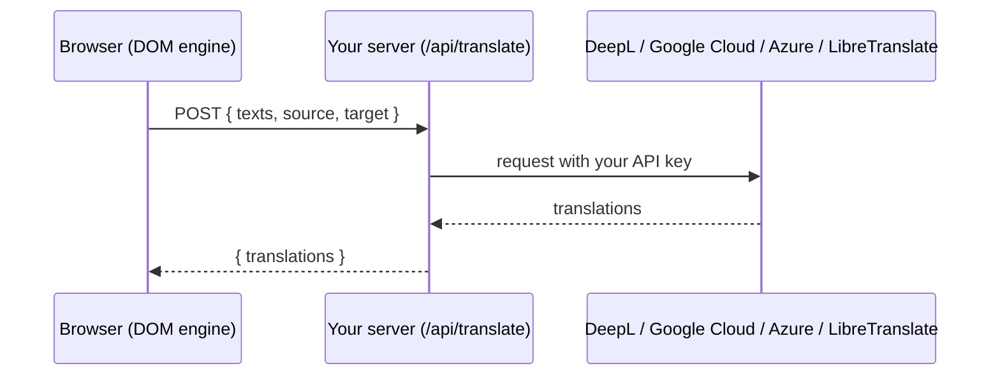

# Translation Providers

By default, the package translates through Google's free Website Translator. That's the right choice for most sites:
it costs nothing, needs no account and no server code, and covers 248 languages. It has three drawbacks, and a
provider removes all of them:

- **It isn't supported.** Google closed the Website Translator to new sites in 2019. Existing integrations still
  work, but Google makes no promise that they'll keep working.
- **You can't choose the translation engine.** For European languages, many people find DeepL's translations read
  more naturally.
- **Your page's text goes to Google.** For some organizations that's a problem in itself.

A provider replaces Google's widget with the package's own **DOM engine**, which sends your page's text to a
translation service you choose. Everything you've built stays the same: the components, `changeLanguage()`, the
cookie, `?lang=` links, right-to-left handling and events.

```ts
import { createGoogleTranslate, endpointProvider } from '@ken_de_nigerian/vue-google-translate-widget'

app.use(
  createGoogleTranslate({
    provider: endpointProvider({ url: '/api/translate' }),
  }),
)
```

With a provider set, Google's script is never loaded.

## Keep API keys on your server

Paid translation services authenticate with an API key, and anyone who has the key can spend your money with it.
Anything in your JavaScript bundle is visible to every visitor, so **the key must never be in the browser**.

The pattern is the one most payment and AI integrations use: the browser asks *your* server to translate some text,
and your server, which holds the key, asks the service.



`endpointProvider` is the browser side. [Server Handlers](server-handlers.md) gives you the server side in one line
for Nuxt, Next.js, Hono, Cloudflare Workers, Express and more, plus the request format if you want to write it
yourself.

## Choosing a service

| Service | Strengths | Set up with |
| --- | --- | --- |
| **DeepL** | Natural-sounding translations, especially between European languages | `endpointProvider` + `deepl()` on your server |
| **Google Cloud Translation** | The widest language coverage, and the same engine as the free widget | `endpointProvider` + `googleCloud()` on your server |
| **Azure AI Translator** | A good fit if you're already on Azure | `endpointProvider` + `azure()` on your server |
| **LibreTranslate** | Open source and self-hostable, so no text leaves your infrastructure | `libreTranslate()` directly, or `endpointProvider` + `libreTranslateServer()` |
| **Anything else** | Your own model, an internal service | A `TranslationProvider` of your own ([below](#writing-your-own-provider)) |

Check each service's current language list against the languages you offer before you switch: they don't all
support every language Google's widget does, and their lists change. If a service can't translate into a language,
`changeLanguage()` rejects and the page stays as it was.

## How the DOM engine works

Google's widget is a black box. The DOM engine is yours to reason about, so here's exactly what it does when a
visitor picks a language:

1. **It finds the text.** It walks every text node on the page, plus the `placeholder`, `title`, `alt` and
   `aria-label` attributes. It skips anything inside `translate="no"` or `.notranslate` (including
   [`v-no-translate`](directive.md)), `<script>`, `<style>`, `<code>`, `<pre>`, `<textarea>`, `<svg>` and `<math>`,
   and strings with no letters in them, like "42" or "€12.50".
2. **It removes duplicates.** A recipe site repeats "Prep time", "Serves" and "Add to shopping list" on every card.
   Each distinct string is sent once.
3. **It checks the cache.** Translations are cached, keyed by provider, language pair and text. On a returning visit,
   the page translates without any requests at all.
4. **It sends what's left in batches** of up to 50 strings, so a long page doesn't become one huge request.
5. **It writes the translations back**, keeping the whitespace around each string, and marks `<html>` with `lang`
   and `translated-ltr`/`translated-rtl`, so [right-to-left handling](rtl.md) works.
6. **It keeps watching.** Content Vue renders afterwards (a new route, a `v-if`, a "load more" button) is translated
   as it appears. When Vue updates a translated string, the new text is treated as a new original and translated in
   turn.

It also keeps the original of everything it changed. Switching from French to Yorùbá translates from the originals,
not from the French, so there's no flash of English and no translation-of-a-translation. Restoring the original is
instant and needs no request.

If the service fails partway through, the engine restores the original page, `changeLanguage()` rejects with the
error, and `currentLanguage` goes back to the page's own language.

### Tuning it

```ts
import { createGoogleTranslate, endpointProvider, memoryCache } from '@ken_de_nigerian/vue-google-translate-widget'

createGoogleTranslate({
  provider: endpointProvider({
    url: '/api/translate',
    headers: { 'x-csrf-token': csrfToken },
  }),
  // Translate tooltips stored in a data attribute too
  translateAttributes: ['placeholder', 'title', 'alt', 'aria-label', 'data-tooltip'],
  // Don't persist translations between visits
  cache: memoryCache(),
})
```

The default cache is `localStorageCache()`, which falls back to memory if storage is full or unavailable. A
`TranslationCache` is just `{ get(key), set(key, value) }`, so you can back it with anything synchronous.

## LibreTranslate, straight from the browser

If you run your own LibreTranslate server, the browser can call it directly, with no backend code:

```ts
import { createGoogleTranslate, libreTranslate } from '@ken_de_nigerian/vue-google-translate-widget'

createGoogleTranslate({
  provider: libreTranslate({ url: 'https://translate.lagoseats.example' }),
})
```

Language codes are converted to LibreTranslate's (`iw` becomes `he`, `zh-CN` becomes `zh`, and so on). If your
server requires an API key, don't pass it here unless it's a key restricted to your site; instead, go through your
own endpoint with `libreTranslateServer()` on the server.

## Writing your own provider {#writing-your-own-provider}

A provider is an object with a name and a `translate` function:

```ts
import type { TranslationProvider } from '@ken_de_nigerian/vue-google-translate-widget'

export const inHouseTranslator: TranslationProvider = {
  // Used in cache keys, so changing provider never serves another provider's translations.
  name: 'in-house',
  async translate(texts, source, target, signal) {
    const response = await fetch('/internal/translate', {
      method: 'POST',
      headers: { 'content-type': 'application/json' },
      body: JSON.stringify({ texts, from: source, to: target }),
      signal,
    })
    if (!response.ok) throw new Error(`Translation failed: ${response.status}`)
    const { results } = await response.json()
    return results // same length and order as `texts`
  },
}
```

Three rules:

- **Return one string per input, in the same order.** The engine maps them back by position.
- **Throw on failure.** The engine restores the page and reports the error.
- **Respect `signal`.** It's aborted when the visitor switches language again before your request finishes.

Codes passed to `translate` are Google's (`iw`, `jw`, `zh-CN`). Convert them if your service uses different ones.

## Keeping costs predictable

Paid services charge per character translated. The engine keeps that down by only sending visible, distinct text,
once per language, and caching it. On the server, `createTranslateHandler` caps each request (`maxTexts`,
`maxCharacters`) and can restrict which languages may be requested (`allowedTargets`). For a public site, also put
rate limiting in front of the endpoint, so a script can't run up your bill. [Security, CSP & Privacy](csp-and-privacy.md#protecting-your-translation-endpoint)
has the details.
